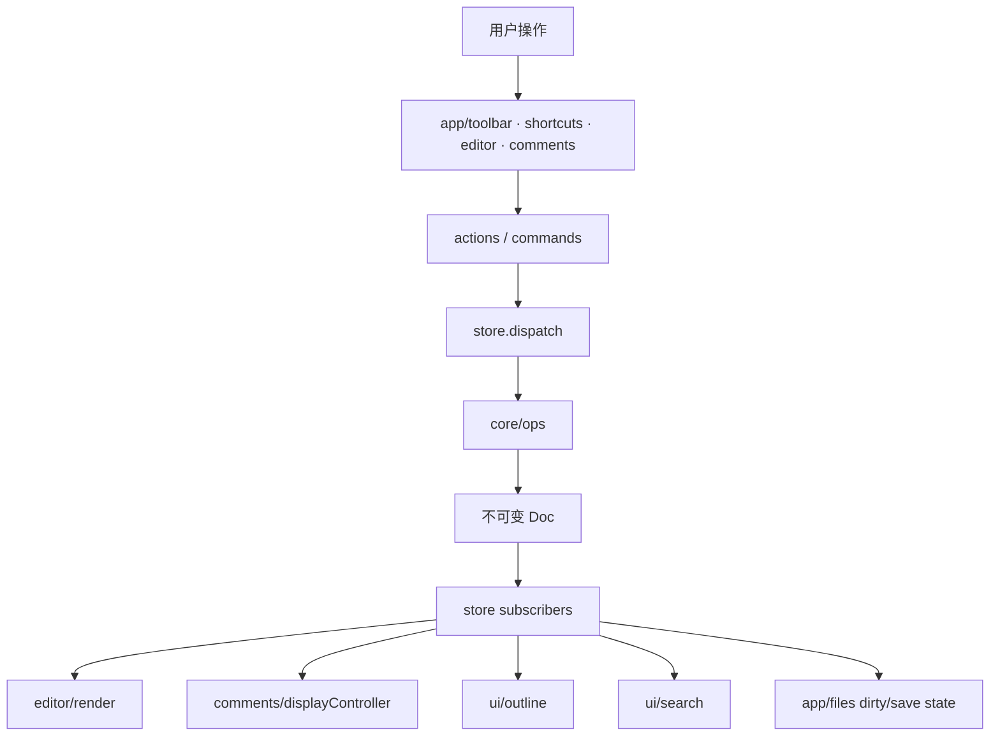

# dafeiyu-notebook 代码结构

## 入口

```text
electron/main.cjs
  └─ preload.cjs
       └─ dist/renderer/index.html
            └─ dist/renderer/app.js
                 └─ src/renderer/app.ts
```

`src/renderer/app.ts` 是组合根，只负责创建 store、renderer、comments、actions、toolbar 等实例，不承载具体业务。

## 顶层目录

```text
src/
├─ core/                    文档模型与纯逻辑
│  ├─ types.ts              Doc / Block / Annotation
│  ├─ doc.ts                迁移、序列化、ID 规范
│  ├─ store.ts              Doc + selection + undo/redo
│  ├─ ops.ts                remove/insert/patch/move 原语
│  ├─ notes.ts              注释、标记、组注释
│  ├─ toc.ts                目录
│  ├─ search.ts             全文搜索
│  ├─ export.ts             Word/PDF 导出 HTML
│  └─ table.ts              表格
│
├─ editor/                  区块编辑层
│  ├─ editing.ts            contenteditable 输入、Enter、Backspace
│  ├─ render.ts             keyed block renderer
│  ├─ format.ts             行内格式
│  ├─ highlight.ts          高亮
│  ├─ sanitize.ts           行内 HTML 白名单
│  ├─ paste.ts              正文粘贴
│  ├─ pointer/              区块选择、拖动、框选、空白点击
│  └─ blocks/               文本/图片/表格/分隔线
│
├─ features/
│  ├─ comments/             注释 feature
│  │  ├─ controller.ts      对外门面 + 编辑生命周期
│  │  ├─ displayController.ts  注释 host 生命周期
│  │  ├─ display.ts         纯注释 DOM 渲染
│  │  ├─ interaction.ts     复制、空白点击提交
│  │  ├─ selection.ts       Alt 注释框选
│  │  ├─ inlineEditor.ts    行内注释编辑器
│  │  ├─ inlineEditorDom.ts 注释编辑器 DOM
│  │  ├─ inlineEditorKeyboard.ts
│  │  ├─ inlineEditorPaste.ts
│  │  ├─ imageTarget.ts     注释图片适配器
│  │  └─ model.ts           注释索引
│  │
│  ├─ image/                通用图片编辑
│  │  ├─ target.ts          ImageTarget 抽象 + 区块实现
│  │  ├─ menu.ts            区块/注释共用菜单
│  │  ├─ crop.ts            裁剪
│  │  └─ ops.ts             翻转/裁剪算法
│  │
│  └─ marks/                标记线、组标记
│
├─ app/                     应用编排层
│  ├─ state.ts              AppState
│  ├─ toolbar.ts            按钮绑定
│  ├─ toolbarStyle.ts       文字颜色/高亮
│  ├─ commentPanel.ts       注释颜色面板
│  ├─ shortcuts.ts          Ctrl+A/C/V/S/Z 等
│  ├─ editorCommands.ts     结束编辑 + undo/redo
│  ├─ editorRuntime.ts      store 订阅、pointer、comments 组合
│  ├─ blockActions.ts       块级动作
│  ├─ files.ts              打开/保存/导入/导出
│  ├─ view.ts               缩放/主题/侧栏
│  └─ plugins.ts            插件门面
│
├─ ui/                      DOM UI
│  ├─ outline.ts            目录
│  ├─ search.ts             搜索面板
│  ├─ colorPanel.ts         通用颜色面板定位
│  ├─ colorPalette.ts       色板
│  ├─ fontLibrary.ts        字体库
│  ├─ contextMenu.ts
│  ├─ menus.ts
│  └─ mark/                 标记面板/图标/选色器
│
├─ storage/                 持久化适配
│  └─ appearance.ts         注释/文字/高亮外观
│
├─ platform/                preload 类型封装
├─ plugins/                 插件宿主（可信本地代码）
└─ renderer/                HTML/CSS/入口
```

## 运行时数据流



所有文档修改都必须经过：

```text
UI command -> store.dispatch -> core/ops -> new Doc -> subscribers
```

`renderer` 和 `comments` 不直接修改 `Doc`。

## Feature 到代码

| 功能 | 主要代码 |
|---|---|
| 区块输入/拆分/合并 | `editor/editing.ts` |
| 区块渲染/复用 | `editor/render.ts` |
| 区块选择/拖动/框选 | `editor/pointer/*` |
| 正文格式/高亮 | `editor/format.ts`、`editor/highlight.ts` |
| 注释 | `features/comments/*` |
| 注释图片 | `features/comments/imageTarget.ts`、`features/image/menu.ts` |
| 图片编辑 | `features/image/*` |
| 标记 | `core/notes.ts`、`features/marks/*`、`ui/mark/*` |
| 目录 | `core/toc.ts`、`ui/outline.ts` |
| 搜索 | `core/search.ts`、`ui/searchMeta.ts`、`ui/search.ts` |
| 文件/导出 | `app/files.ts`、`core/export.ts`、`electron/main.cjs` |
| 字体 | `ui/fontLibrary.ts`、`renderer/fonts/*` |
| 主题/缩放 | `app/view.ts`、`ui/theme.ts` |
| 插件 | `plugins/host.ts`、`ui/plugins.ts` |

## 依赖边界

允许：

```text
core -> 无 DOM / 无 feature
editor -> core
features -> core + editor
ui -> core + platform + storage
app -> 所有层（只做组合）
renderer -> app
```

已收回的边界：

- `editor/pointer` 不再 import `features/comments`；
- 注释图片菜单由 app 注入，不再由 comments 直接 import menu；
- `comments/displayController` 只管 host 生命周期；
- `comments/interaction` 只管文档级交互；
- `ui/colorPanel` 统一面板定位。

剩余边界问题：

- `comments/controller.ts` 仍 import `commentImageTarget`（feature 内适配器，可接受）；
- 插件仍运行在渲染进程，属于可信本地代码模型；
- smoke 主套件仍是一体化长序列。

## 快捷键上下文

```text
输入框 / 注释编辑器 -> 浏览器原生 Ctrl+A
正文普通状态       -> 区块级全选
正文编辑状态       -> 当前区块文本
目录区             -> 目录业务多选
```

## 保存路径

```text
renderer files.save
  -> preload moye.save
  -> main file:save
  -> 路径白名单
  -> writeAtomic(temp -> rename)
  -> renderer dirty=false
```
